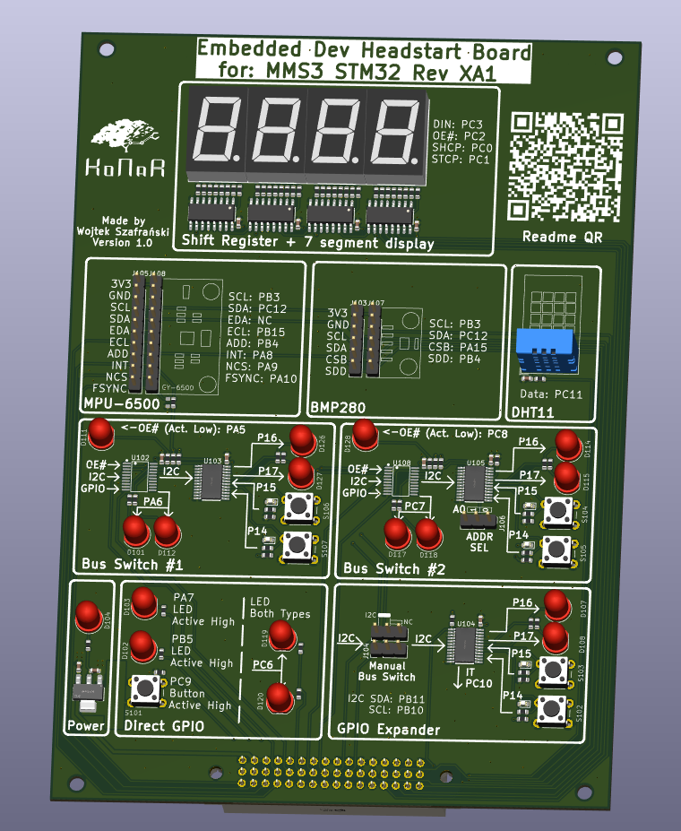

# Embedded_headstart_board

**Język Polski niżej**

## How to use

> [!NOTE]
> Dear trainees, please note that this is the first version of this guide and it may contain errors. If you spot anything or something isn't working as expected, please contact [me](https://github.com/Fiedal) (if it comes to this readme or software) or [owner of this repo](https://github.com/Themuse061) (if it comes to hardware).

### Schematics

First of all, you are going to need software that allows you to read the schematics of the board. That's one of the most important skills for an embedded programmer. My main recommendation is installing **KiCad**, the EDA software in which this board was created. Another great alternative is [KiCanvas](https://kicanvas.org/), an online viewer for KiCad PCB layouts and schematics. It works great for simpler boards like this one, though KiCad is better for more complex projects. Also don't be afraid to google/ask AI how stuff works and don't be afraid to look into datasheets for answers. Soon it will be your main source of informations.

### Altmode and Chainbus mode

MMS3 (the main board that this PCB connects to) has two modes: **Altmode** and **Chainbus mode**. What's the difference?

- **Chainbus mode:** This is the default mode. It lets you stack multiple hats (boards like this one) onto the MMS3 to build a tower (up to 8 boards). The tradeoff is that you only have SPI, I2C, and UART available on each hat. This means you cannot use direct hardware interrupts on peripherals located on the hat. More details will be available in the upcoming ModuCard documentation.

- **Altmode:** This mode is designed for specific use cases (like this headstart board). In Altmode, only a single hat can be connected to the MMS3, but you get access to a whole row of dedicated pins alongside the standard Chainbus interface. You can configure these free pins however you like: direct interrupts, SPI, USART, or ADC! Check the main schematic of this board to see the table showing how each pin can be assigned in Altmode.

> !NOTE
> This board is designed to both have some bus switches with protocols akin to ChainBus and peripherals connected directly like AltMode so you can learn how to work with both.

### Programming

There are several ways to program STM32 microcontrollers: using STM's official HAL (Hardware Abstraction Layer), writing bare-metal code, or using third-party libraries and OSes.

In KoNaR, we primarily use two approaches:

- [StmEpic](https://github.X-Lemon-X/StmEpic) – A library developed within KoNaR (used in Nomad) that acts as an abstraction layer over HAL, integrated with FreeRTOS.
- [Zephyr RTOS](https://docs.zephyrproject.org/latest/index.html) – An RTOS ecosystem used in Hefajstos (and currently being prepared for Nomad). Unlike lightweight RTOSes, Zephyr is a full ecosystem supporting multiple architectures, built-in connectivity stacks, Devicetree hardware description, and Kconfig build control.

We recommend starting with Arduino library in PlatformIO first, as it is beginner-friendly. Later I suggest trying HAL, because it's rips apart some layer of abstraction from arduino so you can better understand what's happening under the hood. Later move on to StmEpic or Zephyr.

All templates are included in this repository in template_XYZ directory, where XYZ is a name of what method is used in this template ie. templete_HAL.

#### HAL

It already includes the base Chainbus pin definitions. All you need to do is configure the Altmode pins inside STM32CubeMX (`.ioc` file), generate the project code, and flash the board.

#### StmEpic

**Incoming**

#### Zephyr

A template for Zephyr RTOS is currently under development. In the meantime, check out this [Zephyr tutorial video](https://www.youtube.com/watch?v=mTJ_vKlMS_4) and refer to the official [Zephyr Documentation](https://docs.zephyrproject.org/latest/index.html). You should also look at the existing [mms_board_definitions repository](https://github.com/KoNaR-Hefajstos/mms_board_definitions).

---

### Dictionary

- **uC / MCU:** Microcontroller Unit
- **GPIO:** General-Purpose Input/Output
- **Blinky:** A simple LED toggling program (the "Hello World" of embedded systems)
- **Debouncing:** Mechanical buttons bounce back and forth rapidly when pressed, causing false triggers. Debouncing (in hardware or software) filters out these quick oscillations to register only a single clean press.

---

### Exercises

Before you move on to the projects make this exercises to train core functionalities of our board.

- [ ] Basic GPIO blinky - use direct GPIOs section to blink the LED
- [ ] Make LED turn on/of with click of a button
- [ ] Add serial print (might be a bit hard at start but useful for debugging), ie. Print "Button pressed" whenever button is pressed and similar.
- [ ] Make blinky through a GPIO expander (Look into the datasheet / google how it works)
- [ ] Use GPIO expander through a bus switch
- [ ] Play around with multiple bus switches at same time (Make blinky on 2 expanders, try to leave 2 bus switches one and write to one expander etc)
- [ ] Read different sensors on the board and print the values
- [ ] Write the sensor values to the 7 segment display

### Projects Ideas

Here are a few project suggestions to help you combine different hardware peripherals on the board. Try bringing up each peripheral individually first before building a full project!

- **Smart Blinky:** Use direct GPIOs to build a status blinky with multiple modes (e.g., fast blink, heartbeat pattern, slow blink). Change modes using a tactile button configured with external interrupts. *Watch out for button debouncing in your interrupt handler!*

- **Home Temperature & Humidity Station:** Read data from the DHT11 sensor and display the temperature or humidity on the 7-segment display. Use a push button to toggle between showing temperature and humidity.

- **Digital Spirit Level / Tilt Sensor:** Use the onboard sensor MPU-6500 to detect tilt. Display the current angle on the 7-segment display or light up specific LEDs on the board depending on whether it's tilted left or right.

- **Simon Says Game:** Use the GPIO Expander section to create a Simon Says memory game. The LEDs blink in a random sequence, and the user must repeat the sequence using the buttons. Add difficulty scaling with faster blinks or longer sequences!

> [!NOTE]
> If you're building one of these projects using HAL, try integrating FreeRTOS to get familiar with multi-tasking concepts. It's not mandatory right away, but understanding RTOS fundamentals will be essential for future KoNaR projects!

## Jak korzystać

> [!NOTE]
> Drodzy praktykanci, pamiętajcie, że to pierwsza wersja tego poradnika i może zawierać błędy. Jeśli zauważycie coś nietypowego lub coś nie działa zgodnie z oczekiwaniami, skontaktujcie się z [mną](https://github.com/Fiedal) (jeśli chodzi o ten readme lub oprogramowanie) albo z [właścicielem tego repozytorium](https://github.com/Themuse061) (jeśli chodzi o sprzęt).

### Schematy

Przede wszystkim będziecie potrzebować oprogramowania, które pozwala czytać schematy płytki. To jedna z najważniejszych umiejętności programisty embedded. Moja główna rekomendacja to instalacja **KiCada**, czyli oprogramowania EDA, w którym ta płytka została zaprojektowana. Inną świetną alternatywą jest [KiCanvas](https://kicanvas.org/), internetowa przeglądarka układów PCB i schematów KiCada. Sprawdza się świetnie przy prostszych płytkach, takich jak ta, choć KiCad jest lepszy przy bardziej złożonych projektach. Nie bójcie się też googlować/pytać AI, jak coś działa, i nie bójcie się zaglądać do datasheetów po odpowiedzi. Wkrótce będą one waszym głównym źródłem informacji.

### Tryb Altmode i tryb Chainbus

MMS3 (główna płytka, do której podłącza się ten PCB) ma dwa tryby: **Altmode** i **Chainbus mode**. Jaka jest różnica?

- **Chainbus mode:** To tryb domyślny. Pozwala układać wiele hatów (płytek takich jak ta) na MMS3, tworząc wieżę (do 8 płytek). Kosztem tego jest to, że na każdym hacie dostępne są tylko SPI, I2C i UART. Oznacza to, że nie możecie używać bezpośrednich przerwań sprzętowych od peryferiów znajdujących się na hacie. Więcej szczegółów pojawi się w nadchodzącej dokumentacji ModuCard.

- **Altmode:** Ten tryb jest przeznaczony do specyficznych zastosowań (jak ta płytka headstart). W Altmode można podłączyć do MMS3 tylko jeden hat, ale oprócz standardowego interfejsu Chainbus zyskujecie dostęp do całego rzędu dedykowanych pinów. Te wolne piny możecie skonfigurować, jak chcecie: jako bezpośrednie przerwania, SPI, USART lub ADC! Sprawdźcie główny schemat tej płytki, na którym znajduje się tabela pokazująca, jak każdy pin można przypisać w Altmode.

> !NOTE
> Ta płytka została zaprojektowana tak, aby zawierała zarówno przełączniki magistrali (bus switche) z protokołami zbliżonymi do ChainBus, jak i peryferia podłączone bezpośrednio jak w AltMode, dzięki czemu możecie nauczyć się pracy z obydwoma podejściami.

### Programowanie

Istnieje kilka sposobów programowania mikrokontrolerów STM32: użycie oficjalnego HAL-a (Hardware Abstraction Layer) od STM, pisanie kodu bare-metal albo korzystanie z bibliotek i systemów operacyjnych firm trzecich.

W KoNaR używamy głównie dwóch podejść:

- [StmEpic](https://github.X-Lemon-X/StmEpic) – biblioteka opracowana w ramach KoNaR (używana w Nomadzie), będąca warstwą abstrakcji nad HAL-em, zintegrowana z FreeRTOS.
- [Zephyr RTOS](https://docs.zephyrproject.org/latest/index.html) – ekosystem RTOS używany w Hefajstosie (i obecnie przygotowywany dla Nomada). W przeciwieństwie do lekkich systemów RTOS, Zephyr jest pełnym ekosystemem wspierającym wiele architektur, z wbudowanymi stosami komunikacyjnymi, opisem sprzętu za pomocą Devicetree i kontrolą budowania przez Kconfig.

Zalecamy, aby zacząć od biblioteki Arduino w PlatformIO, ponieważ jest przyjazna dla początkujących. Później proponuję spróbować HAL-a, ponieważ usuwa on część warstw abstrakcji znanych z Arduino, dzięki czemu lepiej zrozumiecie, co dzieje się „pod maską”. Następnie przejdźcie do StmEpic lub Zephyra.

Wszystkie szablony znajdują się w tym repozytorium w katalogu template_XYZ, gdzie XYZ to nazwa użytej metody w danym szablonie, np. templete_HAL.

#### HAL

Zawiera już bazowe definicje pinów Chainbus. Wystarczy skonfigurować piny Altmode w STM32CubeMX (plik `.ioc`), wygenerować kod projektu i wgrać go na płytkę.

#### StmEpic

**Wkrótce**

#### Zephyr

Szablon dla Zephyr RTOS jest obecnie w trakcie tworzenia. W międzyczasie obejrzyjcie ten [film z tutorialem do Zephyra](https://www.youtube.com/watch?v=mTJ_vKlMS_4) i zajrzyjcie do oficjalnej [dokumentacji Zephyra](https://docs.zephyrproject.org/latest/index.html). Powinniście też zerknąć na istniejące [repozytorium mms_board_definitions](https://github.com/KoNaR-Hefajstos/mms_board_definitions).

---

### Słownik

- **uC / MCU:** Microcontroller Unit (mikrokontroler)
- **GPIO:** General-Purpose Input/Output (uniwersalne wejścia/wyjścia)
- **Blinky:** Prosty program migający diodą LED („Hello World” świata embedded)
- **Debouncing (eliminacja drgań styków):** Mechaniczne przyciski odbijają się szybko tam i z powrotem po naciśnięciu, co powoduje fałszywe wyzwolenia. Debouncing (sprzętowy lub programowy) filtruje te szybkie oscylacje, aby zarejestrować tylko jedno czyste naciśnięcie.

---

### Ćwiczenia

Zanim przejdziecie do projektów, wykonajcie te ćwiczenia, aby przećwiczyć podstawowe funkcjonalności naszej płytki.

- [ ] Podstawowy blinky na GPIO – użyjcie sekcji bezpośrednich GPIO, aby zamigać diodą LED
- [ ] Zróbcie tak, aby dioda LED włączała/wyłączała się po kliknięciu przycisku
- [ ] Dodajcie wypisywanie przez port szeregowy (na początku może być trochę trudne, ale przydaje się do debugowania), np. wypisujcie „Button pressed” za każdym razem, gdy przycisk zostanie naciśnięty, i podobne komunikaty.
- [ ] Zróbcie blinky przez ekspander GPIO (zajrzyjcie do datasheetu / wygooglujcie, jak to działa)
- [ ] Użyjcie ekspandera GPIO przez bus switch
- [ ] Pobawcie się kilkoma bus switchami jednocześnie (zróbcie blinky na 2 ekspanderach, spróbujcie zostawić włączone 2 bus switche i pisać do jednego ekspandera itp.)
- [ ] Odczytajcie różne czujniki na płytce i wypiszcie ich wartości
- [ ] Zapiszcie wartości z czujników na wyświetlaczu 7-segmentowym

### Pomysły na projekty

Oto kilka propozycji projektów, które pomogą wam połączyć różne peryferia dostępne na płytce. Zanim zbudujecie pełny projekt, spróbujcie najpierw uruchomić każde peryferium osobno!

- **Smart Blinky:** Użyjcie bezpośrednich GPIO, aby zbudować blinky statusowy z wieloma trybami (np. szybkie miganie, wzorzec „bicia serca”, wolne miganie). Zmieniajcie tryby za pomocą przycisku tact skonfigurowanego z przerwaniami zewnętrznymi. *Uważajcie na drgania styków przycisku w obsłudze przerwania!*

- **Domowa stacja temperatury i wilgotności:** Odczytujcie dane z czujnika DHT11 i wyświetlajcie temperaturę lub wilgotność na wyświetlaczu 7-segmentowym. Użyjcie przycisku do przełączania między wyświetlaniem temperatury i wilgotności.

- **Cyfrowa poziomica / czujnik przechylenia:** Użyjcie wbudowanego czujnika MPU-6500 do wykrywania przechylenia. Wyświetlajcie aktualny kąt na wyświetlaczu 7-segmentowym lub zapalajcie określone diody LED na płytce w zależności od tego, czy jest przechylona w lewo, czy w prawo.

- **Gra Simon Says:** Użyjcie sekcji ekspandera GPIO, aby stworzyć grę pamięciową Simon Says. Diody LED migają w losowej sekwencji, a użytkownik musi powtórzyć sekwencję za pomocą przycisków. Dodajcie skalowanie trudności przez szybsze miganie lub dłuższe sekwencje!

> [!NOTE]
> Jeśli budujecie jeden z tych projektów z użyciem HAL-a, spróbujcie zintegrować FreeRTOS, aby oswoić się z pojęciem wielozadaniowości. Nie jest to obowiązkowe od razu, ale zrozumienie podstaw RTOS-ów będzie niezbędne w przyszłych projektach KoNaR!
