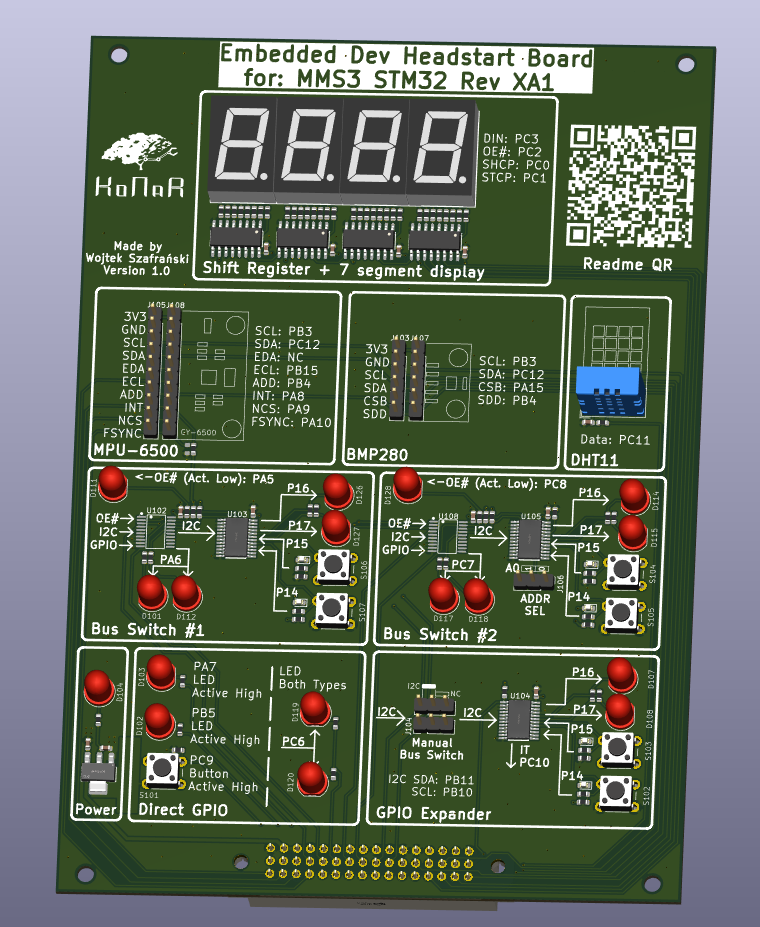

# Embedded_headstart_board

## How to use

> [!NOTE]
> Dear trainees, please note that this is the first version of this guide and it may contain errors. If you spot anything or something isn't working as expected, please contact [me](https://github.com/Fiedal) (if it comes to this readme or software) or [owner of this repo](https://github.com/Themuse061) (if it comes to hardware).

### Schematics

First of all, you are going to need software that allows you to read the schematics of the board. That's one of the most important skills for an embedded programmer. My main recommendation is installing **KiCad**, the EDA software in which this board was created. Another great alternative is [KiCanvas](https://kicanvas.org/), an online viewer for KiCad PCB layouts and schematics. It works great for simpler boards like this one, though KiCad is better for more complex projects.

### Altmode and Chainbus mode

MMS3 (the main board that this PCB connects to) has two modes: **Altmode** and **Chainbus mode**. What's the difference?

- **Chainbus mode:** This is the default mode. It lets you stack multiple hats (boards like this one) onto the MMS3 to build a tower (up to 8 boards). The tradeoff is that you only have SPI, I2C, and UART available on each hat. This means you cannot use direct hardware interrupts on peripherals located on the hat. However, you can still control simple peripherals using a GPIO expander. More details will be available in the upcoming MODUCAR and MMS3 documentation.

- **Altmode:** This mode is designed for specific use cases (like this headstart board). In Altmode, only a single hat can be connected to the MMS3, but you get access to a whole row of dedicated pins alongside the standard Chainbus interface. You can configure these free pins however you like: direct interrupts, SPI, USART, or ADC! Check the main schematic of this board to see the table showing how each pin can be assigned in Altmode.

*Note:* On this specific board, you don't need to manually switch modes – it was designed specifically to work in **Altmode**.

### Programming

There are several ways to program STM32 microcontrollers: using STM's official HAL (Hardware Abstraction Layer), writing bare-metal code, or using third-party libraries and OSes.

In KoNaR, we primarily use two approaches:
- [StmEpic](https://github.X-Lemon-X/StmEpic) – A library developed within KoNaR (used in Nomad) that acts as an abstraction layer over HAL, integrated with FreeRTOS.
- [Zephyr RTOS](https://docs.zephyrproject.org/latest/index.html) – An RTOS ecosystem used in Hefajstos (and currently being prepared for Nomad). Unlike lightweight RTOSes, Zephyr is a full ecosystem supporting multiple architectures, built-in connectivity stacks, Devicetree hardware description, and Kconfig build control.

We recommend starting with **HAL** first, as it is beginner-friendly and helps you understand what happens under the hood before moving to StmEpic or Zephyr.

#### HAL
Clone this [template repository](https://github.com/Fiedal/MMS-embedded-headstart-software-base). It already includes the base Chainbus pin definitions. All you need to do is configure the Altmode pins inside STM32CubeMX (`.ioc` file), generate the project code, and flash the board.

#### StmEpic
**TODO**

#### Zephyr
A template for Zephyr RTOS is currently under development. In the meantime, check out this [Zephyr tutorial video](https://www.youtube.com/watch?v=mTJ_vKlMS_4) and refer to the official [Zephyr Documentation](https://docs.zephyrproject.org/latest/index.html). You can also look at the existing [mms_board_definitions repository](https://github.com/KoNaR-Hefajstos/mms_board_definitions).

---

### Dictionary
- **uC / MCU:** Microcontroller Unit
- **GPIO:** General-Purpose Input/Output
- **Blinky:** A simple LED toggling program (the "Hello World" of embedded systems)
- **Debouncing:** Mechanical buttons bounce back and forth rapidly when pressed, causing false triggers. Debouncing (in hardware or software) filters out these quick oscillations to register only a single clean press.

---

### Project Ideas

Here are a few project suggestions to help you combine different hardware peripherals on the board. Try bringing up each peripheral individually first before building a full project!

- **Smart Blinky:** Use direct GPIOs to build a status blinky with multiple modes (e.g., fast blink, heartbeat pattern, slow blink). Change modes using a tactile button configured with external interrupts. *Watch out for button debouncing in your interrupt handler!*

- **Home Temperature & Humidity Station:** Read data from the DHT11 sensor and display the temperature or humidity on the 7-segment display. Use a push button to toggle between showing temperature and humidity.

- **Digital Spirit Level / Tilt Sensor:** Use the onboard sensor MPU-6500 to detect tilt. Display the current angle on the 7-segment display or light up specific LEDs on the board depending on whether it's tilted left or right.

- **Simon Says Game:** Use the GPIO Expander section to create a Simon Says memory game. The LEDs blink in a random sequence, and the user must repeat the sequence using the buttons. Add difficulty scaling with faster blinks or longer sequences!

> [!NOTE]
> If you're building one of these projects using HAL, try integrating FreeRTOS to get familiar with multi-tasking concepts. It's not mandatory right away, but understanding RTOS fundamentals will be essential for future KoNaR projects!
